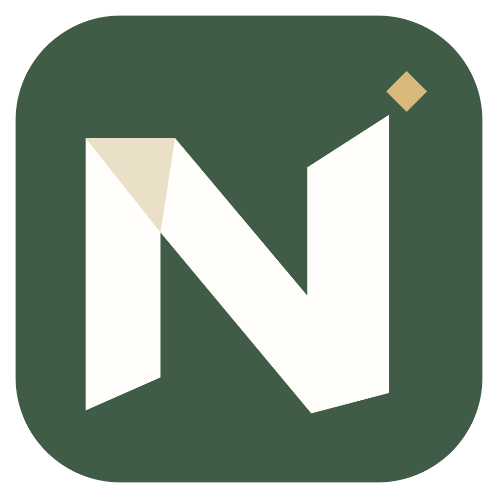
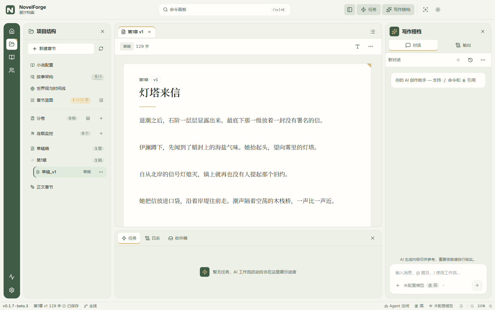
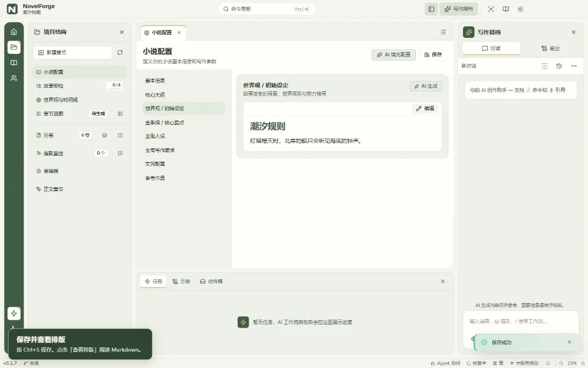
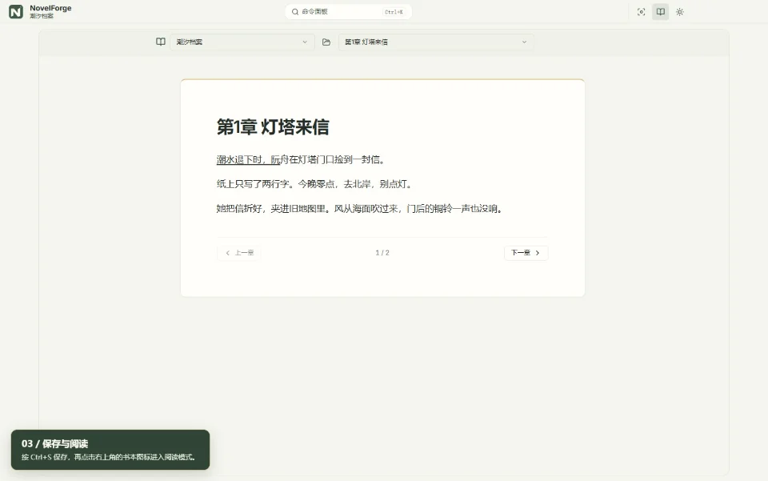

<div align="center">



# NovelForge

**An open-source desktop writing workspace for long-form fiction, with AI built in.**

Plan your world, cast, and chapters. Draft, revise, and finalize the manuscript in the same app.

[](https://github.com/LunaRime/novelforge/releases/latest)
[](https://github.com/LunaRime/novelforge/actions/workflows/build.yml)
[](LICENSE)

**[Download for Windows](https://github.com/LunaRime/novelforge/releases/latest) · [Project website](https://lunarime.github.io/novelforge/) · [Changelog](CHANGELOG.md)**

[简体中文](README.md) · **English** · [Русский](README.ru.md)

</div>



## Quick start

On the [stable release page](https://github.com/LunaRime/novelforge/releases/latest), choose the Windows x64 installer, `NovelForge-{version}-Installer.exe`, or extract `NovelForge-{version}-Portable.7z` and run `NovelForge.exe`. The app is available in Simplified Chinese, English, and Russian.

### Create or open a novel project

[](https://lunarime.github.io/novelforge/media/quickstart.webm)

Choose **New Project** on the welcome screen, give your novel a name, and pick a local folder. To continue an existing novel, choose **Open Project** and select its folder. In the workspace, use the sidebar to switch among novel settings, chapter blueprints, manuscripts, and the knowledge base.

### Edit a manuscript and read chapters

[](https://lunarime.github.io/novelforge/media/writing.webm)

Open a chapter from the sidebar, select text in the editor, and use the formatting controls to apply Markdown styles such as bold or italics. After saving, open **Reading mode** to browse novels and chapters in a dedicated read-only view. When you switch back to a chapter, the reader restores its scroll position.

## Writing features

| Stage | What you can do |
| --- | --- |
| Plan a novel | Manage worldbuilding, plot, and character profiles. Break an outline into chapter blueprints, organize them into volumes, and track progress on a chapter board. |
| Draft and revise | Write on a Markdown manuscript page and use focus mode to concentrate on the current paragraph. Stream an AI draft, rewrite selected passages, request editorial reviews, and compare versions using snapshots and experimental branches. |
| Maintain continuity | Track events, foreshadowing, and character state with chapter, volume, and book summaries. Inspect, edit, and rebuild the project's AI memory. |
| Give AI project context | Search research and story material in a local knowledge base that combines full-text and semantic search. The writing assistant can consult project context, run workflows, and use tools from MCP servers. |
| Manage models and usage | Use OpenAI-compatible services such as OpenAI and DeepSeek, Gemini, Anthropic, or local Ollama. Assign different models to creative, analytical, and lightweight tasks, and track writing activity, calls, tokens, and cost. |

Add a provider in the app's model settings and enable the models you want to use. A local Ollama embedding model enables offline semantic search in the knowledge base.

## Architecture and data

React 19, TypeScript 6, and CodeMirror 6 power the writing interface, which is built with Vite 8. Electron 43 runs the renderer in a sandbox and connects it to the main process through typed IPC. The independent TypeScript core defines writing and storage use cases and can be compiled separately.

Standard projects store chapters and settings on your machine. SQLite stores relational data and full-text indexes, and LanceDB stores vector indexes. AI requests go to the configured model service. With a remote provider, the context sent for a request can include manuscript excerpts or retrieved material. You can also route AI requests to local models.

- [Architecture documentation](docs/architecture/README.md) covers the application layer, core use cases, and storage design.
- The [architecture overview](screenshots/architecture.en.png) was generated with [archify](https://github.com/tt-a1i/archify) from its [diagram source](docs/diagrams/novelforge-architecture.en.json).

## Run from source

Use **Node.js 22.19+** and **pnpm 9.15.4**. If you need to compile native dependencies, install Python 3 and your platform's C++ toolchain. On Windows, use Visual Studio Build Tools with the C++ desktop development workload.

```sh
git clone https://github.com/LunaRime/novelforge.git
cd novelforge
pnpm install
pnpm run dev
```

```sh
pnpm run typecheck
pnpm run lint
pnpm run test
```

Run `pnpm run rebuild` if `better-sqlite3` needs to be rebuilt against Electron's ABI. The [development tools script](scripts/dev-instance.mjs) can manage isolated instances and open the developer console.

<details>
<summary>Package the Windows installer and portable build</summary>

Open PowerShell on Windows and run these commands.

```powershell
$env:npm_config_user_agent = 'pnpm/9.15.4'
$env:CSC_IDENTITY_AUTO_DISCOVERY = 'false'
$env:ELECTRON_BUILDER_BINARIES_MIRROR = 'https://npmmirror.com/mirrors/electron-builder-binaries/'
pnpm run build
```

Build output is organized under `release/{type}/{version}/`. Stable builds go to `release/stable/{version}/` and include the NSIS installer, portable build, and update metadata.

</details>

## License and credits

NovelForge is open source under the [GPL-3.0](LICENSE). It began as a fork of [Vela](https://github.com/heider-x/vela) by heider-x and is maintained by [LunaRime](https://github.com/LunaRime). Feedback is welcome on [GitHub Issues](https://github.com/LunaRime/novelforge/issues).
