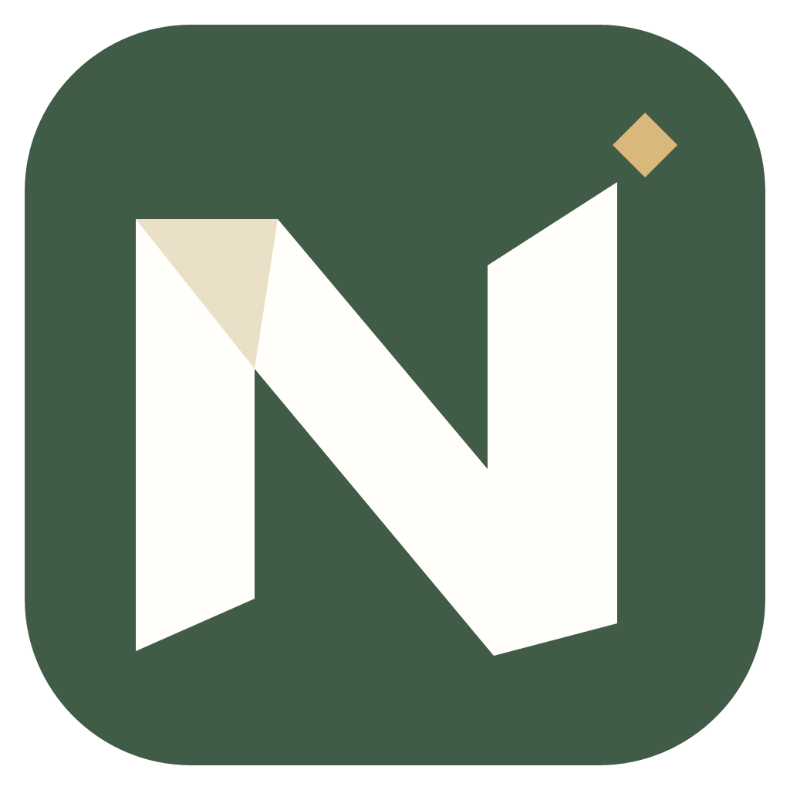
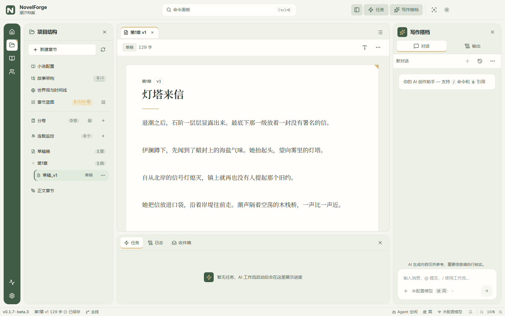
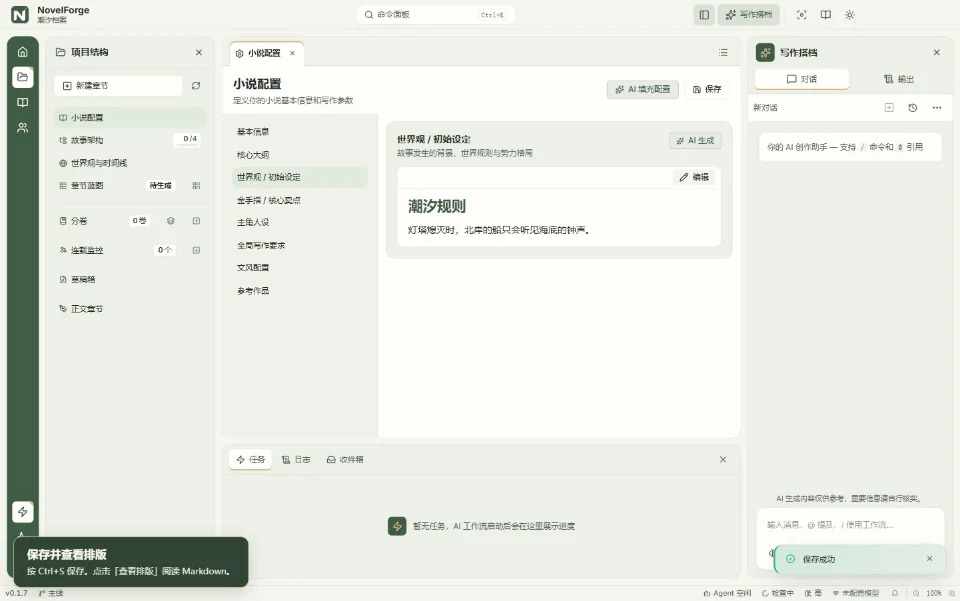
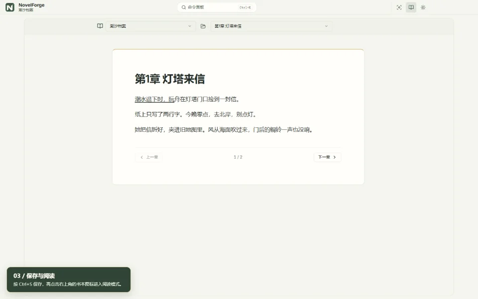

<div align="center">



# NovelForge

**为长篇小说作者打造的开源 AI 写作工作台。**

从世界观、人物和章节蓝图，到正文写作、修订与定稿，在同一个桌面应用里推进整本书。

[](https://github.com/LunaRime/novelforge/releases/latest)
[](https://github.com/LunaRime/novelforge/actions/workflows/build.yml)
[](LICENSE)

**[下载 Windows 版](https://github.com/LunaRime/novelforge/releases/latest) · [项目主页](https://lunarime.github.io/novelforge/) · [更新日志](CHANGELOG.md)**

**简体中文** · [English](README.en.md) · [Русский](README.ru.md)

</div>



## 快速上手

在 [正式版下载页](https://github.com/LunaRime/novelforge/releases/latest) 选择 Windows x64 安装程序 `NovelForge-{version}-Installer.exe`，或下载便携版 `NovelForge-{version}-Portable.7z`，解压后运行 `NovelForge.exe`。应用界面支持简体中文、英文和俄文。

### 创建或打开小说项目

[](https://lunarime.github.io/novelforge/media/quickstart.webm)

在欢迎页选择 **新建项目**，填写作品名称并选择本地目录。也可以选择 **打开项目** 并定位到已有项目文件夹。进入工作台后，用侧栏在作品设定、章节蓝图、稿件和知识库之间切换。

### 编辑稿件与阅读章节

[](https://lunarime.github.io/novelforge/media/writing.webm)

在侧栏打开一章稿件，在编辑器中选中文字，使用格式工具添加粗体、斜体等 Markdown 格式。保存后可进入 **阅读模式**，在独立的只读视图中切换小说和章节。返回刚读过的章节时，阅读视图会恢复滚动位置。

## 创作功能

| 场景 | 可以做什么 |
| --- | --- |
| 规划长篇 | 管理世界观、主线和角色档案，把大纲拆成可按卷组织的章节蓝图，并在章节看板查看全书进度。 |
| 写作与修订 | 在 Markdown 稿纸上写作和专注阅读。使用流式 AI 写稿、选段润色和多角色审稿，并用快照与实验分支比较同章的不同写法。 |
| 跨章保持一致 | 通过章节、分卷和全书三级作品记忆追踪情节、伏笔与角色状态。可查询、编辑和重建记忆。 |
| 让 AI 查阅作品 | 为剧情、资料和设定建立本地知识库，同时使用全文与语义检索。写作搭档可以读取项目上下文、调用创作工作流，并通过 MCP 扩展工具。 |
| 管理模型与用量 | 使用 OpenAI 兼容服务（如 OpenAI、DeepSeek）、Gemini、Anthropic 或本机 Ollama。为创作、分析和轻量任务选用不同模型，并查看字数、调用、Token 和费用统计。 |

在应用的模型设置中添加供应商并启用所需模型，即可使用 AI 写作功能。使用本机 Ollama 嵌入模型时，知识库可离线进行语义检索。

## 架构与数据

React 19、TypeScript 6 和 CodeMirror 6 提供写作界面，Vite 8 构建前端。Electron 43 的沙箱渲染进程通过带类型契约的 IPC 调用主进程。独立的 TypeScript 核心定义创作与存储用例，并可单独编译验证。

常规项目的章节和设定保存在本机，SQLite 存放关系数据与全文索引，LanceDB 存放向量索引。AI 请求使用你配置的模型服务。使用远程供应商时，请求所需的稿件或检索片段会随上下文发送给对方。应用也支持通过本机模型处理 AI 请求。

- [架构文档](docs/architecture/README.md)介绍应用层、核心用例和存储方案。
- [架构概览图](screenshots/architecture.zh.png)由 [archify](https://github.com/tt-a1i/archify) 根据[图源](docs/diagrams/novelforge-architecture.zh.json)生成。

## 从源码运行

准备 **Node.js 22.19+** 和 **pnpm 9.15.4**。如需从源码编译原生依赖，安装 Python 3 和当前平台的 C++ 工具链，Windows 使用含 C++ 桌面开发组件的 Visual Studio Build Tools。

```sh
git clone https://github.com/LunaRime/novelforge.git
cd novelforge
pnpm install
pnpm run dev
```

```sh
pnpm run typecheck
pnpm run lint
pnpm run test
```

遇到 Electron 与 `better-sqlite3` 的 ABI 不匹配时，运行 `pnpm run rebuild`。开发者控制台和隔离实例可通过[开发工具脚本](scripts/dev-instance.mjs)管理。

<details>
<summary>打包 Windows 安装版和便携版</summary>

在 Windows 上打开 PowerShell 并运行以下命令。

```powershell
$env:npm_config_user_agent = 'pnpm/9.15.4'
$env:CSC_IDENTITY_AUTO_DISCOVERY = 'false'
$env:ELECTRON_BUILDER_BINARIES_MIRROR = 'https://npmmirror.com/mirrors/electron-builder-binaries/'
pnpm run build
```

构建产物会按版本类型归档到 `release/{type}/{version}/`。正式版位于 `release/stable/{version}/`，包含 NSIS 安装程序、便携版和自动更新元数据。

</details>

## 许可证与致谢

NovelForge 以 [GPL-3.0](LICENSE) 开源，源自 heider-x 的 [Vela](https://github.com/heider-x/vela)，由 [LunaRime](https://github.com/LunaRime) 持续开发维护。欢迎通过 [GitHub Issues](https://github.com/LunaRime/novelforge/issues) 提交反馈。
