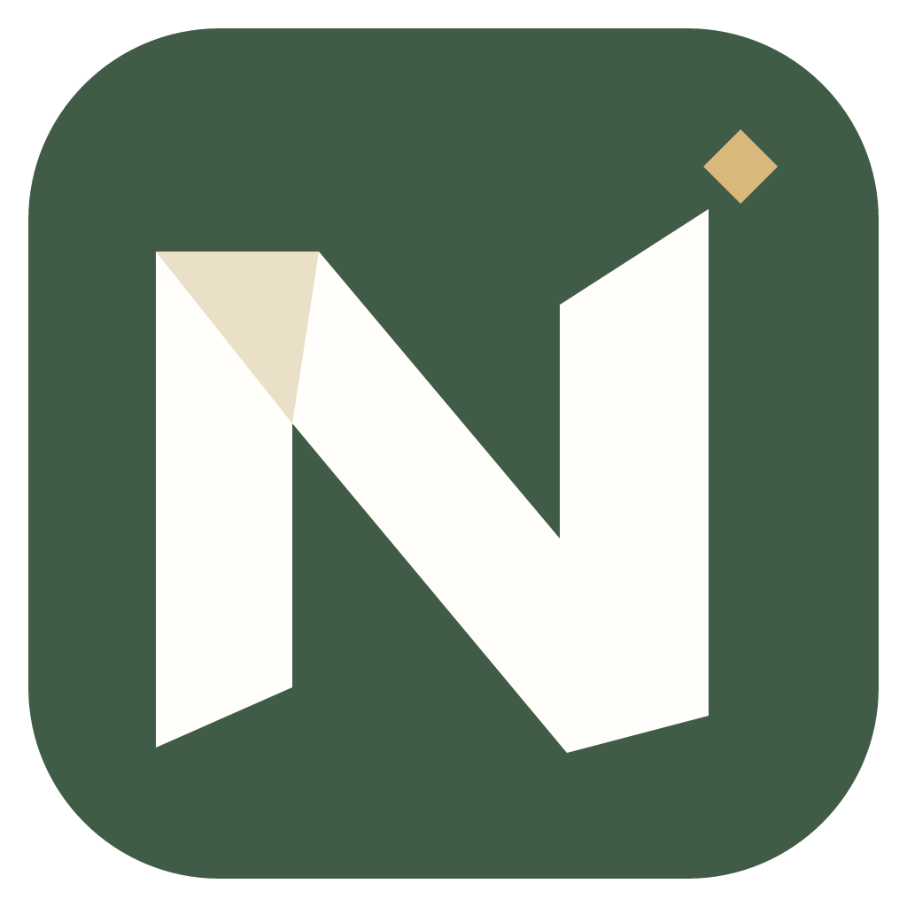
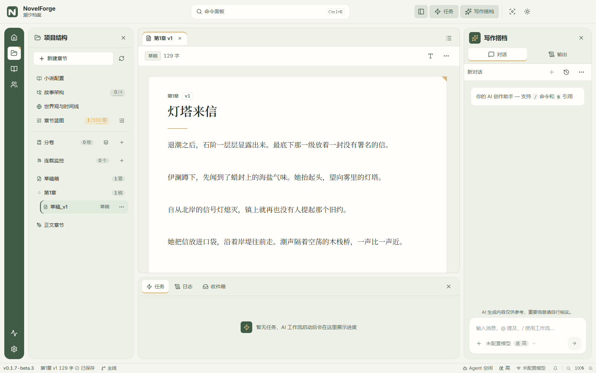
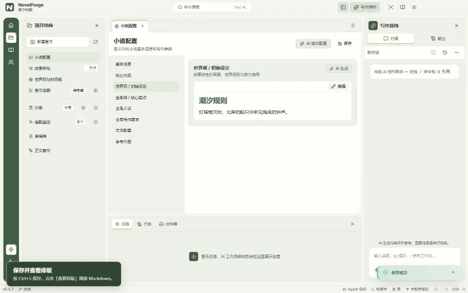
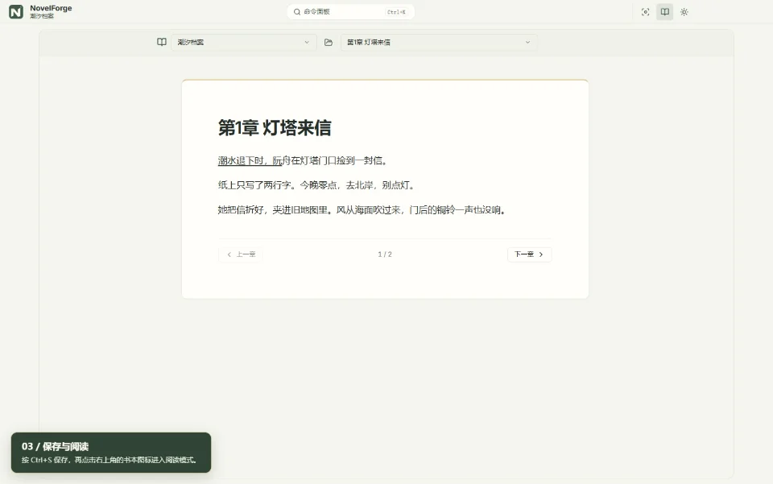

<div align="center">



# NovelForge

**Открытое настольное приложение для работы над романами со встроенным ИИ.**

Создавайте мир и персонажей, планируйте главы, пишите и редактируйте рукопись в одном приложении.

[](https://github.com/LunaRime/novelforge/releases/latest)
[](https://github.com/LunaRime/novelforge/actions/workflows/build.yml)
[](LICENSE)

**[Скачать для Windows](https://github.com/LunaRime/novelforge/releases/latest) · [Сайт проекта](https://lunarime.github.io/novelforge/) · [История изменений](CHANGELOG.md)**

[简体中文](README.md) · [English](README.en.md) · **Русский**

</div>



## Быстрый старт

На [странице стабильного выпуска](https://github.com/LunaRime/novelforge/releases/latest) скачайте установщик для Windows x64 `NovelForge-{version}-Installer.exe` либо распакуйте архив `NovelForge-{version}-Portable.7z` и запустите `NovelForge.exe`. Интерфейс доступен на русском, английском и упрощённом китайском языках.

### Создание и открытие проекта

[](https://lunarime.github.io/novelforge/media/quickstart.webm)

На экране приветствия выберите **Новый проект**, введите название романа и укажите папку на компьютере. Чтобы продолжить работу над существующей книгой, выберите **Открыть проект** и укажите её папку. В боковой панели можно переключаться между настройками романа, планами глав, рукописью и базой знаний.

### Редактирование рукописи и чтение глав

[](https://lunarime.github.io/novelforge/media/writing.webm)

Откройте главу в боковой панели, выделите фрагмент в редакторе и примените форматирование Markdown, например полужирное начертание или курсив. Сохраните изменения и откройте **Режим чтения**, чтобы читать рукописи и переключаться между книгами и главами. При возврате к главе приложение восстанавливает позицию прокрутки.

## Возможности

| Этап | Что можно делать |
| --- | --- |
| Планирование романа | Описывайте мир, сюжет и персонажей. Разбивайте общий план на главы, распределяйте их по томам и следите за ходом работы на доске глав. |
| Написание и редактура | Работайте с рукописью в Markdown. Генерируйте черновики с потоковым выводом, перерабатывайте выделенные фрагменты, запрашивайте редакторский разбор и сравнивайте варианты с помощью снимков и экспериментальных веток. |
| Связность повествования | Отслеживайте события, сюжетные зацепки и развитие персонажей с помощью сводок глав, томов и всей книги. Память проекта можно просматривать, редактировать и пересоздавать. |
| Контекст для ИИ | Ищите материалы в локальной базе знаний с полнотекстовым и семантическим поиском. Помощник может обращаться к контексту проекта, запускать рабочие процессы и подключать инструменты через MCP. |
| Модели и расходы | Подключайте OpenAI-совместимые сервисы, включая OpenAI и DeepSeek, а также Gemini, Anthropic или локальную Ollama. Назначайте отдельные модели для написания текста, анализа и простых задач. Следите за объёмом текста, вызовами, токенами и расходами. |

Добавьте поставщика в настройках моделей и включите нужные модели. С локальной моделью эмбеддингов Ollama семантический поиск в базе знаний работает без интернета.

## Архитектура и данные

Интерфейс написан на React 19 и TypeScript 6, редактор использует CodeMirror 6, а сборка выполняется в Vite 8. В Electron 43 процесс интерфейса работает в песочнице и взаимодействует с главным процессом через типизированный IPC. Независимое ядро на TypeScript определяет операции работы над рукописью и хранения данных. Его можно компилировать отдельно.

Главы и настройки обычных проектов хранятся на вашем компьютере. SQLite хранит реляционные данные и полнотекстовые индексы, а LanceDB — векторные индексы. Запросы ИИ направляются выбранному поставщику. При обращении к удалённому сервису вместе с запросом могут передаваться отрывки рукописи и материалы, найденные в базе знаний. Запросы также можно направлять локальной модели.

- [Документация по архитектуре на китайском](docs/architecture/README.md) описывает прикладной слой, ядро и схему хранения.
- [Обзорная схема на английском](screenshots/architecture.en.png) создана с помощью [archify](https://github.com/tt-a1i/archify) из [исходного файла схемы](docs/diagrams/novelforge-architecture.en.json).

## Запуск из исходного кода

Установите **Node.js 22.19+** и **pnpm 9.15.4**. Если потребуется собрать нативные зависимости, установите Python 3 и инструменты сборки C++ для своей платформы. Для Windows подойдёт Visual Studio Build Tools с компонентами разработки классических приложений на C++.

```sh
git clone https://github.com/LunaRime/novelforge.git
cd novelforge
pnpm install
pnpm run dev
```

```sh
pnpm run typecheck
pnpm run lint
pnpm run test
```

Если `better-sqlite3` требуется пересобрать под ABI Electron, выполните `pnpm run rebuild`. [Скрипт разработчика](scripts/dev-instance.mjs) позволяет управлять изолированными экземплярами приложения и открывать консоль разработчика.

<details>
<summary>Сборка установщика и портативной версии для Windows</summary>

В Windows откройте PowerShell и выполните следующие команды.

```powershell
$env:npm_config_user_agent = 'pnpm/9.15.4'
$env:CSC_IDENTITY_AUTO_DISCOVERY = 'false'
$env:ELECTRON_BUILDER_BINARIES_MIRROR = 'https://npmmirror.com/mirrors/electron-builder-binaries/'
pnpm run build
```

Результаты сборки сохраняются в `release/{type}/{version}/`. В папке стабильного выпуска `release/stable/{version}/` находятся установщик NSIS, портативная версия и метаданные обновления.

</details>

## Лицензия и авторы

NovelForge распространяется по лицензии [GPL-3.0](LICENSE). Проект основан на [Vela](https://github.com/heider-x/vela) от heider-x. Разработку и поддержку ведёт [LunaRime](https://github.com/LunaRime). Замечания и предложения можно оставить в [GitHub Issues](https://github.com/LunaRime/novelforge/issues).
