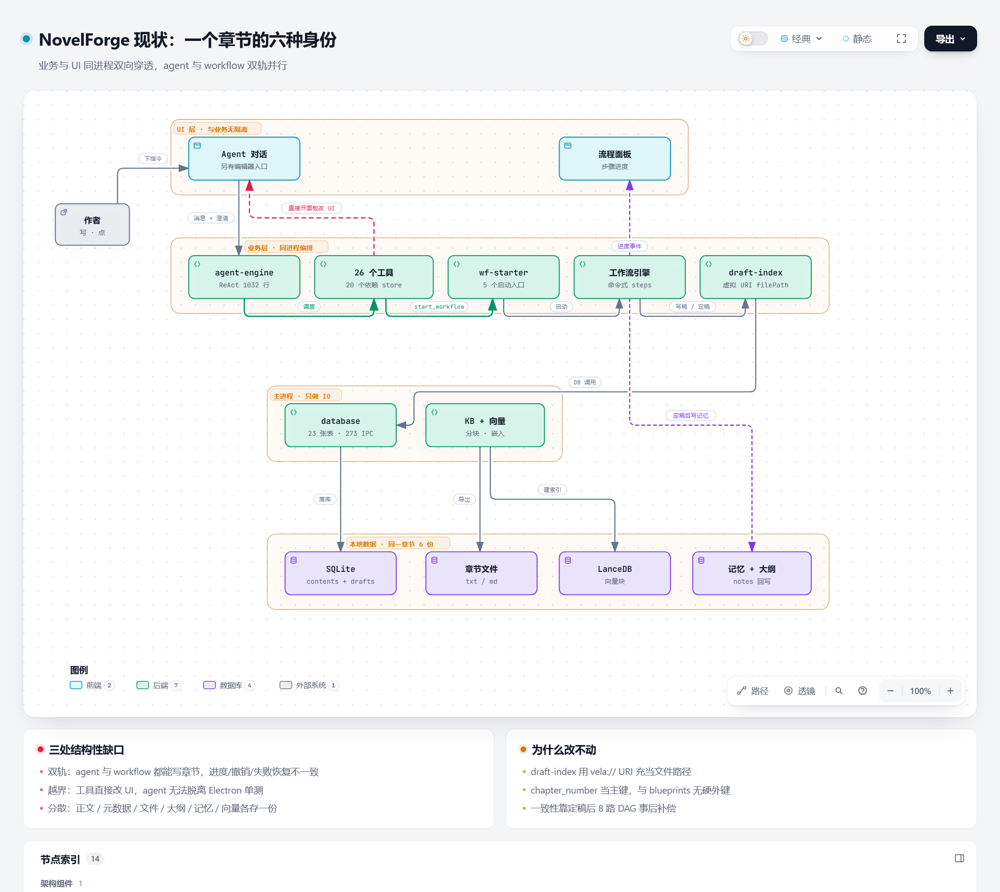

# 01 · 现状诊断：一个章节的六种身份

> 阅读顺序：**01 现状** → [02 目标](02-target-architecture.md) → [03 路线](03-roadmap.md) → [04 施工](04-refactor-plan.md)
>
> 交互版图：[`../diagrams/novelforge-current.zh.html`](../diagrams/novelforge-current.zh.html)　｜　调研全文：[`../2026-10-28-architecture-comparison.md`](../2026-10-28-architecture-comparison.md)



---

## 一句话结论

**六个对标项目都把「事实」放在一个不可变的日志或模型里，UI 是它的投影；NovelForge 反过来了——UI 状态是事实，数据模型是投影，而且为了迁就 UI 在伪造字段。**

这就是那根刺。它不是一个 bug，是**表达与事实的分离**。

---

## 一、三处结构性缺口

### 缺口 1：双轨执行

「写一章」有三个入口，走三套逻辑：

| 入口 | 路径 | 状态推进 |
|---|---|---|
| UI 按钮 | `workflow-starter.startChapterWorkflow()` → `createChapterWorkflow` | step 回调 |
| Agent 工具 | `start_workflow` tool → 同一个 workflow-starter | step 回调 |
| Agent 直接写 | `write_file` / `edit_file` 写正文 | 无 |

`workflow` 是命令式步骤链，`agent` 是 ReAct 循环。两套东西都自称能完成创作，但：

- 状态推进方式不同（step 回调 vs tool observation）
- 失败恢复不同（workflow 有 rehydrate，agent 只有重试）
- 对 UI 的报告方式不同（workflow progress vs tool artifact）

**体感**：同样的操作，有时有进度条有时没有；有时能撤销有时不能；有时会追问有时不问。

### 缺口 2：没有单一事实源

一个「章节」在系统里有 6 种表示：

| 表示 | 位置 | 谁写 |
|---|---|---|
| 正文 | `contents.body`（SQLite） | 写稿 / 编辑 |
| 草稿元数据 | `drafts` 行（version / status / hash） | 状态流转 |
| 「文件」 | `DraftMeta.filePath` / `fileName` | —— |
| 大纲要点 | `blueprints` 表 + `notes` | 定稿后处理 |
| 记忆 | `summary_snapshots` / 章节记忆文件 | 后处理 DAG |
| 向量 | LanceDB chunk | `kb_import` |

而 `DraftMeta` 自己承认了这件事：

```ts
// src/services/draft-index.ts:18
chapterTitle?: string  // 为了兼容保留（UI极少直接从draft拿），实际上可不填

fileName: `draft_v${version}.md`      // 纯显示串，DB 里不存在这个文件
filePath: `vela://draft/${id}`         // 虚拟 URI，被 editor-store 当作文档身份
```

**`fileName` 是伪造的，`filePath` 不是。** 后者是 `vela://draft/{id}`——一个合法的虚拟 URI（IDE 的 untitled buffer 也是这么做的），问题不在造假，而在**它被当成了文档身份**：编辑器的标签、脏标记、版本 diff 全靠这个字符串，于是"章节"这个实体在 UI 里等于一条 URI。

所以这里要治的不是"删掉伪造字段"这么简单：`fileName` 删得掉，`filePath` 得**换成 `docId`** 才能删——这是两件事，混在一起做必然拆坏标签页。

更严重的是 `drafts` 表注释：

```sql
chapter_number INTEGER NOT NULL,  -- 归属章节（与 blueprints 松散关联，导入时先于蓝图创建）
-- 注：chapter_number 与 blueprints 无硬 FK
```

**没有硬外键。** 章、纲、正文之间靠 `chapter_number` 这个数字松散关联。所以「第 3 章」不是一个实体，是一个约定。

一致性因此只能靠**定稿后处理 DAG 事后补偿**（`kb_import` 单根，8 路并行：剧情要点 / 角色状态 / 关系 / 伏笔 / 文风 / 声音 / 审计 / 记忆）。这个 DAG 越复杂，越说明上游模型不收敛。

### 缺口 3：UI 是架构的第一约束

| 层 | 行数 | 占比 |
|---|---|---|
| `src/components` | 38,353 | 34% |
| `src/services` | 31,555 | 28% |
| `electron` | 22,163 | 20% |
| `src/stores` | 7,115 | 6% |

> 口径：非测试 TS/TSX 物理行，2026-10-28 实测（全仓 112,448 行 + 测试 45,822 行）。

**UI 比业务层还大。** 这在 agent 类项目里是异常值——pi 的 TUI 只占 15%（19.8k / 130.7k），主体代码花在会话、压缩、扩展加载上；Claude Code 的 51 万行里，架构主体是 `query/` + `tools/` + `compact/` + `permissions/`，UI 只是入口。

配套证据：

- `src/shared/ipc-channels.ts` **1,614 行、273 个通道**。renderer 和 main 之间不是「域接口」，是扁平 RPC 表。
- `agent-store.ts` **2,064 行**，一个 store 同时装：会话消息、UI 折叠状态（`showHistory` / `memoryView`）、运行时状态（`generating` / `activeRequestId` / `agentProgress`）、观测数据（`sendObservations`）。
- **26 个 agent 工具里有 20 个从 `stores/*` 取依赖（77%）**：工具内共 34 处 `getState()`，其中 `project-store` 17 处（工具运行时去全局状态捞「当前项目路径」，而不是被注入），`editor-store` 11 处直接改 UI，其余 `vector-config`(2)、`workflow`/`draft`/`layout`/`agent` 各 1 处。`start-workflow.tool.ts` 甚至在工具执行中调 `useLayoutStore.getState().openRightPanel('ai-output')`。
- `ToolArtifact` 定义了 **13 种产物类型**，全部为 UI 渲染服务。

后果是一条**只能加不能改**的路径：

> 想改数据模型 → 要改 UI → 怕改 UI → 伪造字段 → 兼容层累积 → 新人（包括你自己）读到「貌似合理但前后不一致」的代码 → **说不出哪里不对，但用着不对**。

---

## 二、为什么你的两份评审文档都说「健康」

`docs/architecture-review.md` 的结论是「框架整体健康、分层清晰、架构纪律很好的样本」，`docs/project-structure-review.md` 说「目录组织整体健康」。

它们没错，但**检查的维度不对**：

| 评审检查的 | 你实际感觉到的 |
|---|---|
| 文件放对目录了吗 | 同一个概念是不是只有一处定义 |
| IPC 有没有白名单 | 一次修改要跨几个进程才能生效 |
| 命名规范吗 | 数据模型是否诚实 |
| 有没有死代码 | 两套执行路径会不会打架 |

前者是**结构规整度**，后者是**语义一致性**。一个项目完全可以「目录极整齐 + 模型极混乱」。

---

## 三、六个项目的共同点（对比结论）

| | 形态 | 代码量 | agent 内核 | 事实源 |
|---|---|---|---|---|
| **pi** | CLI / SDK | agent 2.5k + 产品 76.5k | `packages/agent`，6 文件 2541 行 | append-only JSONL transcript 树 |
| **deepseek-harness** | Web / CLI / Desktop | 53 万行，397 子包 | core 仅 2.8%，全是插件 | append-only SessionEvent log |
| **denova** | Go 服务 + 浏览器 | Go 254k + TS 146k | 独立 Go module 49.3k | 文件（JSONL + progress.md + 角色卡） |
| **genoffice** | Electron 办公套件 | 759k，AI 占 7.8% | agent-core 3.4k | 文档模型 |
| **Claude Code** | CLI | 513k | query loop + tools | 会话 transcript |
| **NovelForge** | Electron 桌面 | 112k（+45k 测试） | 无独立内核，混在 services | **UI store** |

它们建立的都是同一条**单向事实链**：

```
事件日志 / 文档模型  →  派生视图（消息、UI、摘要）  →  渲染
```

**反向依赖是被禁止的**：UI 不能反过来定义数据长什么样。

---

## 四、怎么判断改对了

不用看架构图，看这三个信号：

1. **改一个章节标题，只改一处代码**（现在要动 DB、导出、索引、记忆四处）。
2. **`pnpm exec tsc -p tsconfig.core.json` 能在删掉 `node_modules/electron` 的机器上通过**。
3. **新人问「章节存在哪」，你能一句话答完**（现在是「DB 里有，文件里也有一份，但文件路径是 UI 的虚拟 URI」）。

第三个信号出现时，那根刺就没了。

---

下一篇：[02 · 目标架构](02-target-architecture.md)
