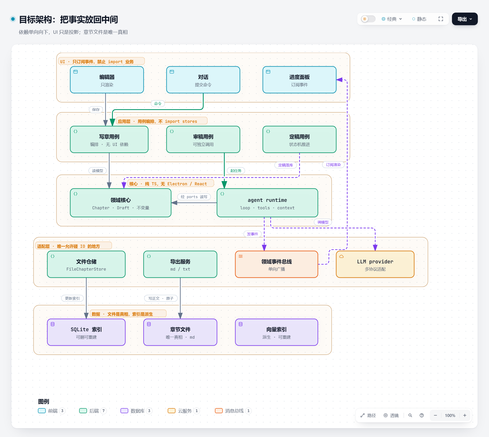

# 02 · 目标架构：把事实放回中间

> 阅读顺序：[01 现状](01-diagnosis.md) → **02 目标** → [03 路线](03-roadmap.md) → [04 施工](04-refactor-plan.md)
>
> 交互版图：[`../diagrams/novelforge-target.zh.html`](../diagrams/novelforge-target.zh.html)



---

## 设计意图

现状图里，箭头是双向的：UI 调业务，业务回头改 UI；工具既能读写数据，又能开面板。

目标图里，**所有箭头只朝一个方向**：UI → 用例 → 领域。反向只允许一件事——领域事件通过总线广播，UI 订阅。

一句话：**领域模型是唯一真相，其余全是投影；投影坏了可以重建，真相不能有第二份。**

---

## 五层职责

| 层 | 放什么 | 绝对不能做 |
|---|---|---|
| **UI** | 编辑器、对话、进度面板 | import 业务层；持有业务状态；定义数据形状 |
| **应用层** | 用例：写章 / 审稿 / 定稿 | import stores；直接碰 SQLite；知道 React 的存在 |
| **核心** | `Chapter` / `Draft` / 不变量 + `agent runtime`（loop / tools / context） | import Electron / React / stores |
| **适配层** | 文件仓储（`FileChapterStore`）、SQLite 索引、导出、LLM、事件总线 | 放业务判断 |
| **数据** | **Markdown 文件（唯一真相）** + SQLite 索引 / FTS / 向量（可删除重建） | 让索引成为真相 |

注意**核心层是并排的两个东西**：领域模型和 agent runtime 在同一层。这不是偷懒，是刻意：

- agent 产生的动作要通过领域接口落地（`ChapterRepo` / `DraftRepo`），不能绕过
- 领域模型不知道 agent 的存在，只知道「有个东西会调我的方法」
- 两者都不依赖 Electron，所以能一起在 Node 里跑测试

这也解决了现状里最扎人的一条：**26 个工具里 20 个从 `stores/*` 拿依赖**。目标图里工具从 `ports` 拿，ports 由应用层注入。

---

## 三条硬规则（写进 lint，不靠自觉）

```js
// .eslintrc.cjs
'no-restricted-imports': ['error', {
  patterns: [
    { group: ['**/stores/*', '**/components/*'],
      message: '核心层禁止依赖 UI / 状态层，请通过 ports 注入' },
    { group: ['electron', 'electron/*'],
      message: '核心层必须是纯 TS，IO 走适配层' },
  ],
}]
```

1. **UI 不许 import 业务层** —— UI 只发命令、订阅事件。
2. **领域核心不 import Electron / React / stores** —— 保证可测、可回放、可移植。
3. **只有适配层碰 IO** —— 换数据库、换模型供应商不改业务代码。

这三条不是风格偏好，是**可测试性的前提**。做不到第 2 条，`pnpm test:runtime` 就永远需要 Electron。

---

## 依赖倒置落在哪里

图里 `SQLite 仓储 → 领域核心` 那条线看起来是「反向」的，其实是标准 DIP：

```
domain/chapter.ts       定义 interface ChapterRepo
adapters/sqlite-repo.ts implements ChapterRepo
application/write-chapter.ts 只依赖 interface
```

编译期依赖指向 domain，运行期由应用层把实现注入。好处很实在：

- 单元测试用内存实现，不碰 SQLite
- 未来要换存储（或加云端同步）只改一个 adapter
- 用例代码里看不到任何 SQL

---

## 与现状的对应关系

| 现状 | 目标 | 迁移动作 |
|---|---|---|
| `src/components/**` | `ui/**` | 只保留渲染，业务回调改成发命令 |
| `src/services/*.ts`（38 个） | `application/**` + `adapters/**` | 按「用例 / 适配」二分，没有第三类 |
| `src/services/agent/**` | `runtime/**` | 拆掉 store 依赖，工具改注入 |
| `src/services/workflows/**` | `application/**` 内部 | 降级为用例实现，不再是平行入口 |
| `src/stores/*` | `ui/state/**` | 只存 UI 状态，业务状态搬走 |
| `electron/database.ts` + `repositories/**` | `adapters/sqlite-chapter-index.ts` | 只保留索引 / FTS / 锁 / 检查点；正文搬去文件 |
| `contents` / `drafts` 表 | `chapters/*.md` + `history/` | 一次性导出（不双写），**旧表冻结不删**（删除不早于 1.0），见 [06 §八](06-storage-design.md) / [08 §三](08-self-review-and-migration.md) |
| `DraftMeta.fileName`（伪造显示串） | 删除 | 见 [04 · M4](04-refactor-plan.md) |
| `DraftMeta.filePath`（`vela://` 虚拟 URI） | 换成 `docId` + `draftUri()` 按需生成 | 见 [04 · M4](04-refactor-plan.md) |

---

## 不要做什么

| 别做 | 原因 |
|---|---|
| 上完整 DDD（聚合根 / 领域事件 / 工厂 / 值对象全套） | 只需要「稳定 ID + 仓储接口 + 用例」，其余是负担 |
| 换掉 SQLite / Zustand | 问题不在选型，在边界 |
| 给 workflow 再加一层抽象 | 目标是减一条路径，不是把两条都做厚 |
| 先改 UI | UI 是当前事实源，先动它等于同时改两头 |
| 一次性重写 | 11 万行，重写必失控 |

---

## 为什么这一层是「框架核心」的雏形

`domain + application + ports + runtime` 四个目录，合起来就是一个可以搬走的核：

- 它不知道 Electron、React、Zustand 存在；
- 它只依赖接口（`ChapterRepo` / `LlmProvider` / `EventBus`），实现由外层注入；
- 它能被独立编译：`tsc -p tsconfig.core.json`，`lib` 只有 ES2022、`types` 只有 node。

这三条同时成立，意味着它将来可以原样搬进 `packages/core`、被 CLI 复用、被测试替身替换——**抽包不是重构目标，是边界干净的副产品**。

所以现在**不**拆 monorepo：`src/core/` + 独立 tsconfig 已经能证明"可抽包"，提前拆包只会多一层 `workspace:*` 的解析噪音。等 core 稳定三个月、接口不再每周变，再搬。

---

## 验收信号

改完之后，这三件事应该同时成立：

- `src/core/**` 下 grep 不到 `stores/`、`components/`、`electron`
- 用内存仓储就能跑通「写章 → 审稿 → 定稿」全流程测试
- `pnpm exec tsc -p tsconfig.core.json` 通过（不需要 Electron 二进制）

---

下一篇：[03 · 改造路线](03-roadmap.md)
