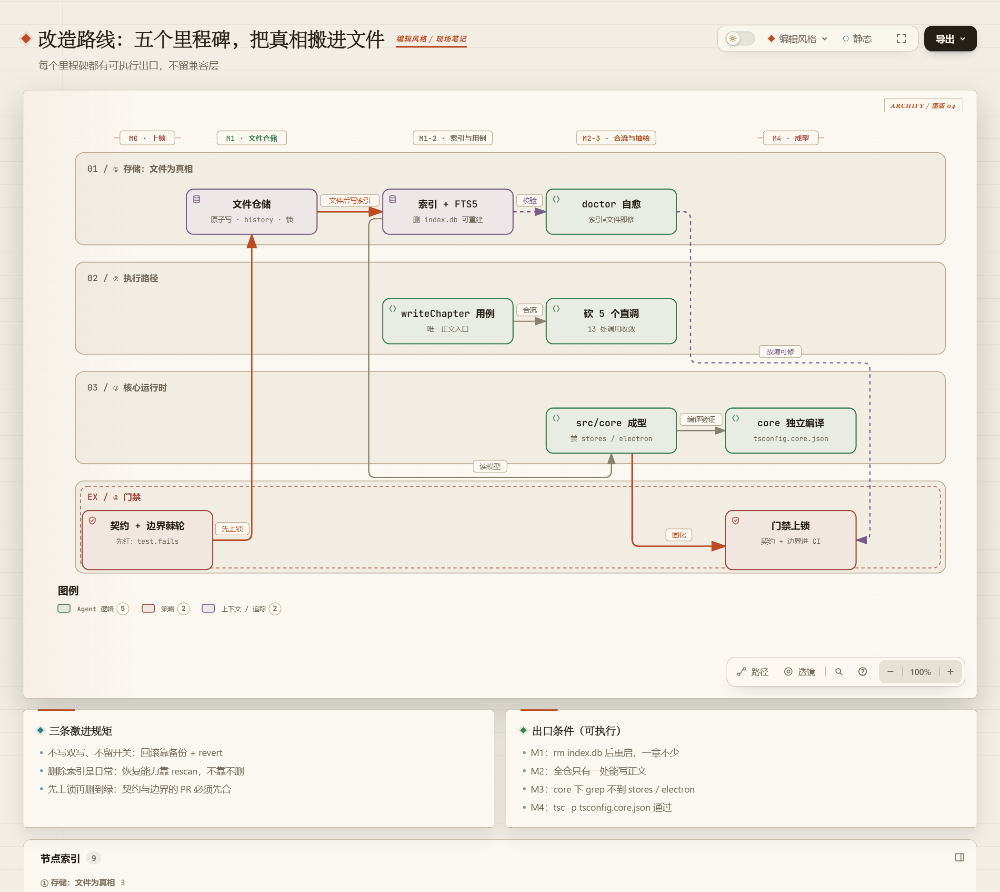

# 03 · 改造路线：五个里程碑，把真相搬进文件

> 当前实施边界（2026-11-05）：本轮仅交付独立存储核心、契约与离线迁移验证；应用入口继续读写现有 DB。下文的文件真相、冻结旧表与 UI/agent 切换属于后续里程碑，尚未启用。迁移输出使用独立空目录，不修改原项目。

> 阅读顺序：[01 现状](01-diagnosis.md) → [02 目标](02-target-architecture.md) → **03 路线** → [04 施工](04-refactor-plan.md)
>
> 存储方案见 [06 · 文件是真相](06-storage-design.md)，DB 职责与规模后路见 [07 · 在文件之上套 DB](07-db-and-scale.md)。
>
> 前置判断：**当前是 0.1.7-beta.3，不是正式版。** 这条路线按 beta 的标准写——不为兼容付利息，不写双写开关，允许破坏性迁移。

---

## 先定一件事：真相放在哪

02 号文档的目标架构解决"层怎么分"，06 号文档解决"数据放哪"。两者叠起来只有一句话：

> **章节正文是 Markdown 文件，`id` 在 frontmatter；SQLite 降级为可删除、可重建的索引。**

判断标准只有一条：**删掉 `.novelforge/index.db`，重启后一章不少。**

这条决定同时解决三件事：单一事实源（文件）、作者心智（能看见能 git）、索引可重建（DB 坏了不慌）。

---

## 为什么删掉「七周」和「四条线并行」

上一版路线是七周日历 + 四条线并行。它有两个错：

1. **单人维护的项目没有并行**，只有上下文切换。四条线同时推进，等于每条线每天都要重新加载一次上下文。
2. **日历会变成承诺。** 一旦某周被现实打断，整张表作废，然后计划被放弃——这比没有计划更糟。

改成五个里程碑，每个都能独立交付、独立停下。判断进度用**出口条件**，不用周数。

---

## 五个里程碑

| 里程碑 | 目标 | 出口条件（可执行） | 允许破坏什么 |
|---|---|---|---|
| **M0 上锁** | 契约测试 + 边界基线 + 脚本，先于任何改动 | `pnpm test:contracts` 有 N 条 `test.fails`；`pnpm check:boundaries` 不超基线 | 无（只加文件） |
| **M1 搬家** | `ChapterRepo` 接口 + `FileChapterStore` + `Indexer`；旧库一次性导出成 md | 删 `index.db` → `rescan` → 章数一致；向两个独立空目录导出，内容与身份一致；`git diff` 能读懂一章改动 | **数据形态改变**（单向导出，回滚=还原备份） |
| **M2 合流** | 章节正文只有一个写入入口 `writeChapter`；workflow 降级为工具实现 | `grep -rn "startChapterWorkflow" src/components` = 0；`write_file` 写 `vela://draft/*` 被拒；契约转正 ≥3 条 | 删除 5 个公开导出（13 处调用点） |
| **M3 抽核** | `src/core/{domain,application,ports,adapters,indexer,runtime}` 成型；工具依赖注入；13 种 artifact → 4 个事件 | `src/core/**` 内 grep 不到 `stores/`、`components/`、`electron`；边界基线归零 | 删 `ToolArtifact` 旧类型、删工具内 `getState()` |
| **M4 成型** | core 可独立编译、单一出口；删兼容字段 | `pnpm exec tsc -p tsconfig.core.json` 通过；`src/core/index.ts` 是唯一出口 | 删 `DraftMeta` 兼容字段、编辑器标签键改 `doc:{id}` |

五个里程碑之间是**硬依赖**：M0 没做就搬数据，等于闭眼改；M1 没做就合流，用例没有章节可引用；M2 没做就抽核，ports 无从定义；M3 没做就谈抽包，边界还在漂。

---

## 三条激进规矩

### 规矩一：代码层不留兼容层，数据层只加不改

06 号文档的初稿里有"第二步：双写 + `NF_STORAGE=file|legacy` 开关"。**这一步砍掉。**

那种开关的代价：每条写路径两个分支、测试 2×2 组合、三个月后没人敢删。beta 期的回滚手段是备份，不是开关：

1. 导出前 `VACUUM INTO .novelforge/backups/pre-file-{ts}.db`；
2. 导出后逐章比对 `content_hash`，不一致就整批中止；
3. 切换读路径，旧表**冻结**（不再写入）；
4. **旧表不删** —— 已发出的 0.1.x 有真实用户在跑（[08](08-self-review-and-migration.md) P0-1），`contents` / `draft_snapshots` 冻结并标记 deprecated，删除不早于 1.0，且须另行完成恢复演练和旧版访问隔离验收。

> **"激进"不等于无差别破坏。** 代码改坏了 `git revert` 就行，**用户数据不行**——那是别人写的东西，删了不可逆。所以两层分开定标准：
>
> | 层 | 标准 | 例子 |
> |---|---|---|
> | 代码 | 激进：不留开关、不留 deprecation 期、不做映射函数 | 删 `ToolArtifact`、删 `filePath` |
> | 数据 | 保守：**只加不改**，原库不动，切换后旧表冻结不删 | 离线导出验证，未来单独切换 |
>
> 影子写入与双写路线已撤销；当前只做离线导出验证，应用仍使用 DB。后续切换文件真相必须另行验收。

同样禁止：`DraftMeta.filePath` / `fileName` 不做 deprecation 期；13 种 `ToolArtifact` 不做映射函数；`chapter_number` 保留列但**从所有 WHERE / JOIN 里撤出**，不留 `chapter_number OR chapter_id` 双条件。

### 规矩二：删除索引不是灾难，是日常

索引层的一切设计都要能回答："删了它怎么回来？"——`chapter_index`、FTS5、 LanceDB 向量、渲染缓存，全部可重建。**唯一不可重建的是 `chapters/*.md` 和 `history/`。**

这条落到工程上：任何"索引写失败"都不回滚文件，只记 warning；启动时 `rescan()` 兜底；`doctor` 命令把所有"文件与索引不一致"的故障模式变成可修复项。

### 规矩三：先上锁，再删到绿

M0 的契约测试、边界基线、`doctor` 骨架必须早于第一行业务改动。之后每个里程碑的动作都是"删掉旧路径 → 跑到绿"，而不是"新增一条路径 → 再想办法迁移"。

---

## 破坏半径（提前说清楚会坏什么）

| 改动 | 数据 | 代码 | 用户可见 |
|---|---|---|---|
| M1 搬家 | 新目录 `chapters/` `volumes/` `setting/` `memory/` `history/`；`.novelforge/index.db` 重建 | 新增 `FileChapterStore` / `Indexer`；`draft-index.ts` 改为读索引 | 项目目录出现可读 md 文件（**这是卖点，要写进 CHANGELOG**） |
| M2 合流 | 无 | 删 5 个导出、13 处调用；`write_file` 禁写 draft | agent 改正文必须先触发写章流程（**行为变化**） |
| M3 抽核 | 无 | runtime 34 个文件改注入；47 处 `getState()` 清零 | 无 |
| M4 成型 | 旧表冻结不删（最早 1.0） | 删 `filePath`/`fileName`；标签键改 `doc:{id}` | 标签页重开后恢复 |

**两处要向用户解释**：M1 之后"稿子变成文件了"（正面），M2 之后"agent 不能悄悄改正文了"（需要适应）。两条都写进 CHANGELOG。

---

## 回滚与风险

| 风险 | 触发条件 | 处置 |
|---|---|---|
| 导出丢章 | 草稿状态过滤错、孤儿草稿 | 导出前统计 `COUNT(*)`，导出后逐章 hash 比对；不一致整批中止 |
| 外部编辑冲突 | 用户用 VS Code 改稿 | hash 漂移 → 重载 + 回写索引；两窗口用文件锁 |
| 文件名与 `number` 不一致 | 重排中途崩溃 | `repairNames()` 启动修复；**文件名是装饰，不是数据** |
| 索引损坏 | 崩溃 / 磁盘问题 | 删 `index.db` 重建；`doctor` 输出差异 |
| 写入半截 | 崩溃在 rename 之前 | `.tmp` 启动时清理；rename 原子，正文要么旧要么新 |
| 回退压力 | 用户不接受文件形态 | beta 版本递增 + CHANGELOG 明示；不为此恢复开关 |
| 旧版打开新库 | 0.1.x 装回后只认 DB | 已发布旧版不识别 storage_meta；当前隔离导出目录并保留原 DB，未来切换须另行设计旧版隔离 |

回滚 = 还原 `.novelforge/backups/pre-file-{ts}.db` + `git revert` 对应 PR。**不提供运行时开关。**

---

## 如果只有三天（最小激进集）

1. **半天**：M0——契约测试（`test.fails`）、边界棘轮、`pnpm test:contracts` / `check:boundaries`。
2. **一天**：`ChapterRepo` + `FileChapterStore`（原子写 / frontmatter / history / 锁）+ `Indexer`（`chapter_index` + FTS5）。
3. **一天**：导出脚本——把 `drafts JOIN contents` 落成 `chapters/*.md`，在独立空目录重复验证内容与身份一致；`rescan` 后章数一致。

三天后你得到：**稿子是文件**、**索引可删可建**、**一条会随改造自动转正的失败清单**。UI 一行没动，但地基换了。

---

## 这个路线里明确不做的事

- 不重写 UI 组件（38k 行，会吞掉全部时间，且不是病根）。
- 不换 SQLite / Zustand / Vite——DB 仍然要做索引、FTS、锁、检查点（见 07）。
- 不引入 DI 容器框架：一个 `container.ts` 足够。
- 不拆 monorepo：`src/core/` + 独立 `tsconfig.core.json` 就能证明"可抽包"；真抽 `packages/core` 是 M5+ 的事。
- 不做多端同步 / 协同编辑：那不是这套方案的目标，见 06 §十一。
- 不在 M1 之前动 `chapter_number` 的显示层。

---

## 改完之后怎么确认

1. `rm .novelforge/index.db` 后重启，一章不少。
2. 改一个章节标题，只改一处代码（现在要动 DB、导出、索引、记忆四处）。
3. `pnpm test:contracts` 里没有 `.fails` 了——全部转正。
4. `pnpm exec tsc -p tsconfig.core.json` 在删掉 `node_modules/electron` 的机器上通过。
5. 新人问"章节存在哪"，一句话答完：**`chapters/0003.md`，frontmatter 里是 `id`，其余都是索引。**

---

下一篇：[04 · 施工细则](04-refactor-plan.md)
