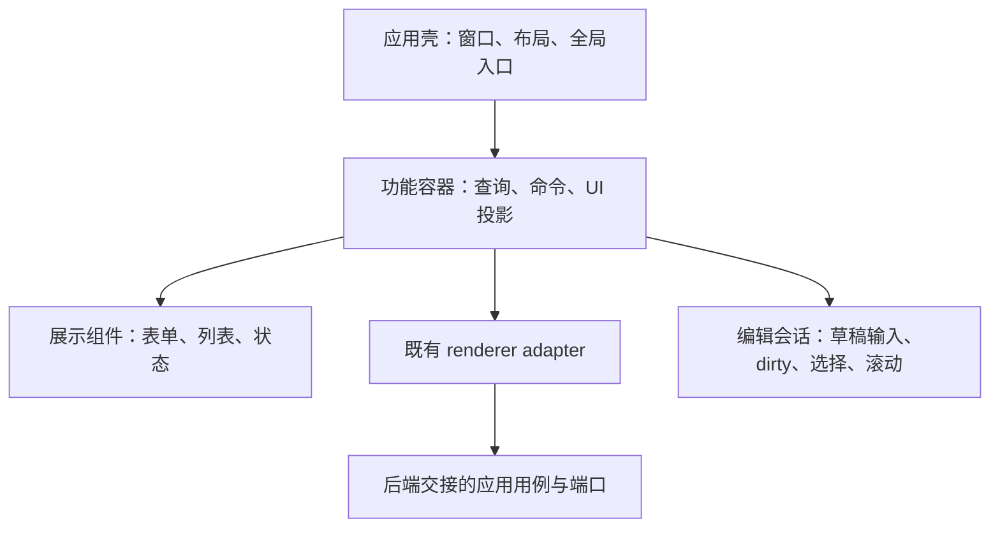

# 后端重构完成后的 UI 与前端重构实施计划

> 2026-11-07。源码观察基线为 `288773d`。计划待后端验收交接后实施。
>
> 执行方式：后端交接验收后，使用 `writing-plans` 为每个 UI 小批补写当时的施工细则，再用 `executing-plans` 或 `subagent-driven-development` 实施、复核和验收。以下所有未勾选项都是未来工作。

**目标**。在稳定的应用用例和存储契约之上，把 NovelForge 整理成以正文写作为中心、导航清楚、AI 任务可控、编辑状态可信的桌面写作工作台。同时降低大组件的修改成本。

**架构**。保留 React、TypeScript、Zustand、CodeMirror、现有 UI 原语和主题。前端按应用壳、功能容器、展示组件、编辑会话分工。业务命令通过 renderer adapter 调用既有应用用例，持久化事实由后端提供。先维持行为拆结构，再分批调整信息层级与交互。

**技术范围**。沿用实施时的锁定依赖与现有编辑器。新组件名是建议落点，实施前核对已有职责，优先复用现有实现。

## 一、先完成什么，才能开始前端施工

先按当前后端路线完成实施和交接验收，再进入 U0。[18 后续重构实施计划](18-followup-implementation-plan.md)

- [ ] C 的章节/草稿、角色与模板等剩余领域操作完成。D 的 store 业务收口、运行时实例与关键链路验收通过。
- [ ] 当前路线包含文件真相切换，交接同时要求 E/F 的生命周期、副本、恢复、身份映射和打包验收通过。若后续决定分期，先在 18 和本文件同步明确交接范围。
- [ ] 输出后端交接表：实际公开用例/adapter 路径、输入输出类型、项目会话标识、文档身份、保存提交点、取消/超时语义、错误/冲突、事件来源、恢复策略及对应测试。
- [ ] 标明哪些内容仍存 DB、哪些已存文件。UI 只接已验收的接口，不自行猜测新路径或重新实现迁移。
- [ ] 保存失败、正文已保存但索引/投影待刷新、过期会话结果、真正取消、超时结果待核验，均有可区分的应用结果。缺少某项契约时先补后端交接项，不在 UI 中伪造成功或失败。
- [ ] 固定交接 commit 与测试/CI 报告，工作区无未归属改动。对打开、编辑、保存、生成、修稿、审稿/定稿、关闭重开完成真实应用验收。

当前基线仍使用 DB 草稿数值身份。未来文件 ChapterId 以交接的映射为准。UI 不把章号当稳定身份，不把当前 `doc:{draftId}` 字符串写死成未来永久协议。正文标签、修稿 diff、审稿报告保留各自语义，不能因指向同一章节而误合并。

## 二、现状依据与改造判断

以下是静态源码观察。U0 重新核对代码，并用实际应用确认待修差距。

| 当前入口 | 已有基础 / 本轮观察 | 前端重构重点 |
|---|---|---|
| `src/App.tsx` | 约 601 行，组合面板、窗口拖拽区、快捷键、启动与全局弹窗 | 分离应用启动与界面壳。维持窗口与布局行为 |
| `src/components/panels/EditorArea.tsx` | 约 1,036 行，混合标签、不同文档视图、正文包装与操作 | 先拆标签及视图分派，再按文档类型接功能容器 |
| `src/components/editor/ChapterCardEditor.tsx` | 约 742 行。加载/保存已迁到应用层，仍有生成/校检/删除等界面职责 | 后端收口后拆列表、编辑表单、操作栏与状态展示 |
| `Sidebar.tsx` / `sidebar/ProjectTree.tsx` | 已有侧栏路由和组组件。工作台已并入项目结构视图 | 统一导航、当前项与展开状态，避免恢复第二套项目导航 |
| `sidebar/BinderVolumeGroup.tsx` | 实际卷成员/顺序投影已接入用例 | 沿用成员语义，继续保留隐藏蓝图索引和旧草稿回退保护 |
| `AIPanel.tsx` / `panels/agent/` | AIPanel 本身约 42 行，Agent 已拆为会话、输入、工具、确认等组件 | 审计真正复杂的会话/输入入口。不为拆文件而拆薄壳 |
| `AIOutputPanel.tsx` | 约 598 行，承担工作流输出展示 | 与 Agent 明确分工，避免把输出文本误作已保存正文 |
| `components/ui/`、`index.css` | 已有 MenuRow、EditorPageHeader、Dialog、Toast 等及四套主题 | 用既有原语建立页面模板与状态规范，减少业务页重复变体 |
| `layout-store.ts` | 保存面板开关/视图/弹窗。拖拽尺寸由面板库管理 | 保持布局状态单一来源，不再加一份宽高字段 |

[2026-10-14 设计审阅](../frontend-design-review.md) 是历史背景。其中大写标签、装饰光晕等已有核销记录。执行 U0 时对照当前源码和 `.agents/skills/` 重新登记真实差距，不能把已修复项再施工一遍。

## 三、整体方案与用户看到的变化

保留桌面工作台骨架，围绕写作任务逐个区域改造。每批同时交付清楚的代码职责、可运行的界面和对应的回归证据。

```text
窗口拖拽区 / 项目名 / 命令入口（保留平台窗口控件留位）
┌──────────┬────────────────────────┬────────────────┐
│ 项目导航 │ 文档标签 / 页面操作      │ AI 会话或任务输出│
│ 卷与章节 │                        │                │
│ 角色设定 │ 正文编辑 / 当前功能页     │ 上下文 / 审批   │
│ 知识资料 │                        │ 任务状态与结果   │
├──────────┴────────────────────────┴────────────────┤
│ 可收起的任务 / 日志等底部工具区                       │
├───────────────────────────────────────────────────┤
│ 当前文档状态 / 保存反馈 / 已有应用状态                 │
└───────────────────────────────────────────────────┘
```

这张草图描述信息分区。U0 根据窗口尺寸和基线验证默认比例。正文占主要面积，侧栏、AI 和底部区仍由用户显式打开/收起。已有视图入口先保留，导航改名或合并必须附旧入口到新入口的对照表和快捷键迁移说明。

| 场景 | 目标体验 | 必须保留的业务语义 |
|---|---|---|
| 日常写作 | 正文清楚、工具安静。当前章、版本和保存状态一眼可见 | dirty、撤销栈、滚动、选择、定稿只读 |
| 卷与章节导航 | 当前章高亮。展开、进入、更多操作各有明确命中区 | 稳定身份、实际卷成员和顺序、打开标签去重 |
| 编辑蓝图/角色/配置 | 列表选择、主表单、页面操作位置一致 | 单项/全量保存差别。等待期间新编辑不被确认掉 |
| AI 辅助写作 | 输入、引用上下文、审批、运行进度与结果有清楚层级 | 会话归属、后台运行、取消终态、结果应用确认 |
| 修稿/审稿 | 原稿、建议、接受操作明确，冲突时保留两份内容 | 真实合并用例、修订版本与只读规则 |
| 读取或保存失败 | 错误与可执行动作就近显示，保留输入，可重试 | 失败不伪装空列表。已提交不能提示重新保存 |

聊天结果沿用明确的应用动作，项目迁移和定稿规则由后端交接。新的产品行为单独排批，先补业务规格与后端契约。

## 四、前端职责怎么拆



| 层次 | 负责 | 约束 |
|---|---|---|
| 应用壳 | 启动挂载、窗口留位、区域布局、全局弹窗与命令路由 | 启动 IO 集中在启动接线处。页面展示不重复初始化服务 |
| 功能容器 | 加载投影、调用命令、映射状态与用户反馈 | 不直连 IPC/DB/文件/模型。用交接时的 adapter，不另造 CRUD 服务 |
| 展示组件 | 接收值和事件，渲染具体功能的表单/列表/工具栏 | 不订阅全局业务 store，不通过动态 import 绕过边界 |
| 编辑会话 | 当前输入、dirty 版本、选中项、标签、局部展开与滚动 | 与持久化事实分开。不复制一份所有章节正文做第二事实源 |
| 投影 store | 跨界面共享、后端可重建的列表/状态投影 | 只订阅所需字段。保存成功按提交版本确认，不盲目清空 dirty |

有多个状态或事件需要协调时提取控制器。简单组件直接接收 props。组件是否继续拆分依据职责、订阅范围和独立验收能力，行数仅用于发现热点。

建议落点：`components/layout/` 维护工作区壳。`components/editor/` 维护文档视图和编辑会话。`components/panels/sidebar/` 维护导航。`components/panels/agent/` 维护 AI 会话。`components/ui/` 只放跨功能复用的原语。先在原目录就近提取，不先全仓搬到 `features/`。

## 五、统一的视觉与交互底盘

实施时以 `.agents/skills/` 的当时有效版本为准，重点对照 color-token、ui-layout、card-affordance、ui-interaction、overlay、writing-tool-aesthetic、i18n 和 save-feedback。

- 继续支持四套主题，保留 UI/写作/等宽三种字体用途。颜色使用语义令牌，z-index 使用现有七级语义变量。不另造业务页调色板。
- 字号、图标、圆角、行高统一到既有刻度。先核对 Tailwind `@theme` 与 CSS 变量的实际计算值，再决定是否补映射。不照抄历史圆角修复建议直接全局替换。
- 页面标题复用 `EditorPageHeader` 等已有实现，分开页面级操作与行内操作。列表/菜单优先复用 `MenuRow`、`SidebarGroup`，同一功能只有一个主触发器。
- 桌面单图标目标按现行规范至少 32×32。触控适配目标 44×44，文字目标遵守现有规则。视觉边界、点击边界和反馈一致。Tab 可达、焦点可见，不能靠 hover 才能发现唯一操作。
- 浮层遵守 Portal/top layer 和语义层级规范。模态有显式关闭出口与 Esc，遮罩行为明确，焦点陷阱/返回与背景锁正确。保持嵌套弹窗、返回后的表单和滚动状态。
- 布局默认比例用百分比字符串，尺寸下限用像素。隐藏/恢复面板沿用安全的松手关闭机制。不在拖拽中卸载区域，不丢失用户布局偏好。
- 界面文案继续三语 `t()`，保留解析依赖的中文键。俄语长文本和窄面板需实测。写作界面保持句子大小写和安静的状态展示，避免新增装饰光晕。

统一状态语义，但不强迫各功能使用一份巨型状态对象：

| 状态 | 界面反馈与动作 |
|---|---|
| 首次加载 | 局部加载提示，尚不能判断为空。不先显示成功空态 |
| 已加载为空 | 说明缺少什么，提供已存在的创建/导入入口 |
| 刷新中 / 部分失败 | 保留同来源投影，显示刷新或局部错误。禁止旧项目投影冒充新项目 |
| 编辑未保存 / 保存中 | 当前文档有持续状态。可编辑时，新编辑仍保持 dirty。禁止重复提交 |
| 保存成功 | 按提交快照确认。沿用手动 toast、日志与自动保存低干扰规则 |
| 已保存、派生刷新失败 | 明确正文已提交，提供刷新/诊断动作，不诱导再次保存正文 |
| 保存失败 / revision 冲突 | 保留输入和撤销上下文，显示失败原因。冲突保留双方版本，不盲目覆盖 |
| AI 运行 / 审批 / 取消中 | 显示当前任务和可执行动作。直到真实终态才显示已取消 |
| 超时、结果待核验 | 不当作确定未提交。核验后再允许可能重复写入的重试 |

## 六、按批实施顺序

执行顺序：后端交接 → U0 → U1 → U2 → U3 → U4 → U5 → U6 → U7。每批再拆成可独立审查的小批，完成一批再叠加下一批，不提交无法运行的中间 UI。

### U0：交接、基线和组件样板

**文件**：本文件、18、现有 `.storybook/`、相关组件 stories/测试与本地验收记录。

- [ ] 完成第一节交接表。记录源码基线，重新检查上述文件的职责和真实热点。
- [ ] 建立导航/正文/蓝图表单/AI 会话/设置五类基线截图，以及长文本、空态、失败态、busy 和 dirty 夹具。只用合成小说数据。
- [ ] 利用已有 Storybook 补必要组件样板。已有 story 则扩充，不另建一套运行时 UI 展示路由。
- [ ] 记录现有窗口尺寸下限、100%/125%/150% 缩放、四主题和三语的真实表现，区分已有缺陷与本批引入回归。
- [ ] 为 U1 写具体拆分清单和失败回归，核对每个建议新文件确有单一职责。

**出口**：可重复打开的场景、后端契约和基线截图齐备。实现阶段不再依靠凭记忆猜旧行为。

### U1：应用壳和布局拆分，先保持行为

**文件**：`App.tsx`、`components/layout/`、`layout-store.ts`、`index.css`、`novel-editor.css`。建议提取 `WorkspaceLayout`、`GlobalDialogs`，启动接线就近独立。

- [ ] 先覆盖面板开关/恢复、拖拽松手关闭、快捷键冲突、布局恢复和脏编辑器仍挂载等风险，再提取壳组件。
- [ ] 分开应用启动与区域渲染。不因重渲染重复订阅服务、注册命令或触发恢复。
- [ ] 布局库继续管理尺寸，layout store 继续管理开关/视图。沿用已有持久化键，必要迁移有默认值和旧偏好回归。
- [ ] 实测 Windows 窗口拖拽/最大化、系统按钮留位。macOS 交通灯和平台快捷键验证按可用设备分别记录。

**出口**：布局与窗口行为等价，正文/会话不因面板开关丢失。壳文件只保留组合职责。

### U2：编辑区、标签与写作体验

**文件**：`EditorArea.tsx`、`DraftEditor.tsx`、`CodeMirrorEditor.tsx`、`VersionHistory.tsx`、`ReviewReport.tsx`、`editor-store.ts` 及现有 editor adapter。建议提取 `EditorTabBar`、`EditorViewHost`。

- [ ] 先测多入口打开去重、切标签/关闭标签、dirty 关闭确认、保存期间输入和旧来源结果，再拆标签栏和文档视图分派。
- [ ] 用明确的文档类型映射选择功能容器。不让所有类型依赖同一个万能组件或共享可变表单状态。
- [ ] 统一文档标题、当前版本、保存状态和主操作位置。正文默认保持舒适阅读宽度，用户现有字号/字体/换行偏好保留。
- [ ] CodeMirror 实例按真实文档会话管理。切换布局/主题不重建文档而清掉撤销、选择、滚动或输入法组合输入。
- [ ] 修稿 diff、审稿报告、历史和定稿只读单独验收。重开受保护编辑会话不能用旧持久化值覆盖。

**出口**：编辑区能按文档类型独立修改。写作主链路和中文输入、撤销重做均通过实际应用验证。

### U3：项目导航、卷与章节列表

**文件**：`Sidebar.tsx`、`ProjectTree.tsx`、`SidebarShared.tsx`、`SidebarGroup.tsx`、`BinderVolumeGroup.tsx`、`VolumeGroup.tsx`、`DraftBoxGroup.tsx`、`ManuscriptGroup.tsx`。

- [ ] 明确“选中/当前文档”“展开/折叠”“打开编辑器”“更多操作”，统一键盘和点击行为，保留每项合法触发器。
- [ ] 导航层只消费后端交接的投影和命令。移除残留 IO 前先增加边界测试，不让 SidebarShared 成为新的业务中心。
- [ ] 卷成员、手动顺序、隐藏蓝图、无蓝图旧草稿、过滤/搜索后的重排目标逐项验收。展示索引不能直接当持久化索引。
- [ ] 展开状态、选中项和滚动按稳定项目/文档身份隔离。切项目及同路径重开不串状态。
- [ ] 大列表先测再优化。虚拟化只有性能证据需要时引入，并保留键盘焦点、拖放和当前项定位。

**出口**：导航清楚且与真实数据一致。不增加另一套草稿身份、卷关系或项目入口。

### U4：蓝图、角色、架构和知识库功能页

**文件**：`ChapterCardEditor.tsx`、`CharacterEditor.tsx`、`NovelConfigEditor.tsx`、`WorldBuildingEditor.tsx`、`KnowledgeOverview.tsx`、`KnowledgePanel.tsx` 及对应生成/编辑弹窗。

- [ ] 先选蓝图页作“列表—表单—状态—操作”样板，拆功能容器与展示组件。单项/批量保存、dirty 和生成结果应用逻辑复用已交接用例。
- [ ] 将同一模板推广至角色/配置/架构页面，但保留角色改名、字段生成冲突和架构部分失败的领域差别。
- [ ] 知识库明确列表、详情、搜索/索引状态和维护操作。维护进度、部分失败和导出结果可见，执行时保持原互斥约束。
- [ ] 窄面板下改为清楚的上下分区或单列详情，返回保留选择和表单。不同时压缩列表与表单至不可读。
- [ ] 复核已有保存、改名、同路径重开、加载失败和生成期间编辑的回归，不以新样式替换掉保护逻辑。

**出口**：同类操作在同类位置，页面可读。领域特殊行为仍由各自用例和测试保证。

### U5：AI 会话、任务与输出反馈

**文件**：`AIPanel.tsx`、`AIOutputPanel.tsx`、`panels/agent/AgentConversation.tsx`、`AgentInputBox.tsx`、`WorkflowProgressEntry.tsx`、`PendingToolConfirmation.tsx`、`ArtifactCard.tsx`、`BottomPanel.tsx`、`LogsView.tsx`。

- [ ] 保留现有 Agent 组件体系，梳理会话选择、上下文输入、任务步骤、工具审批、产物和错误的层级，不重建第二套消息 store。
- [ ] 区分 Agent 对话和工作流输出：输出预览、保存产物、应用到当前正文是不同动作，只有实际提交后才显示已保存。
- [ ] 展示运行、等待审批、取消中、完成、失败、部分成功和待核验结果。后台任务切换不丢失来源与进度。
- [ ] 模型流只更新所属消息/任务，不让整棵项目树或所有编辑表单随 token 重渲染。跟随滚动尊重用户主动向上阅读。
- [ ] 工具审批保持原批准范围和结果顺序，失败重试不跳过审批。输入框与提及/文件/模型浮层在窄高窗口可用。

**出口**：用户能判断任务在做什么、需要什么动作、结果是否已应用。流式输出不明显拖慢正文输入。

### U6：设置、欢迎页与公共交互收尾

**文件**：`components/settings/`、`pages/WelcomePage.tsx`、`components/dialogs/`、命令面板、通知中心、状态栏、`components/ui/` 及 locale 字典。

- [ ] 延续已有设置分区，明确作用范围和保存方式。切设置页/弹窗不会丢未保存输入或隐式覆盖项目配置。
- [ ] 欢迎页保留新建/打开/导入/最近项目等实际入口，不用宣传内容占据主要操作区。项目不可用时提供明确错误动作。
- [ ] 公共控件变更先覆盖真实使用场景，再逐页替换。避免全局 CSS 一次改变所有密度、圆角和弹窗尺寸。
- [ ] 全面核对键盘、焦点、Tooltip、模态关闭、返回、滚动锁、三语溢出和主题对比。操作名称在菜单、按钮、命令入口一致。

**出口**：主界面、设置与弹窗遵循同一套交互语言，保留既有功能入口和平台行为。

### U7：集成、性能、真机与发布前验收

- [ ] 用同一合成项目跑打开→选择章节→编辑/保存→AI 生成→修稿→合并→审稿/定稿→关闭重开，核对内容、身份、历史与状态。
- [ ] 故障场景覆盖读失败、保存拒绝、冲突、刷新失败、切项目、同路径重开、取消/超时及应用重启。确认错误时输入仍可恢复。
- [ ] 分别记录主题/语言/缩放/窗口矩阵、键盘完整路径、长列表、长正文、长会话性能和无关区域重渲染证据。
- [ ] 真机测试使用 `computer-use` 技能。Windows 是本地必验，其他平台有条件实测则附证据，无设备标记未验，CI 不能替代窗口行为验收。
- [ ] 使用真实打包应用再验窗口、字体、浮层、编辑输入、持久化布局和重启恢复。只有 Vite build 不能判定桌面 UI 已交付。
- [ ] 按既有发布流程单独安排发版。UI 批次不自行修改版本号、升级依赖或发布安装包。

## 七、如何验证，不只看“截图好看”

### 场景与指标

| 维度 | 场景 / 验收方法 |
|---|---|
| 窗口布局 | 建议 1280×800、1440×900、1920×1080 及应用允许的最小窗口。四区开关组合、拖拽恢复、窗口缩放无面板异常。视口不足时仍能显式收起工具区 |
| 文本与主题 | zh-CN/en-US/ru-RU × 四主题 × 100%/125%/150% 缩放。长标题/模型名/错误提示不遮住必要按钮，无不可达操作 |
| 核心输入 | 中文输入法组合、复制粘贴、撤销重做、光标/选择、长正文滚动、自动/手动保存交错 |
| 异步与数据 | 项目 A→B、同路径重开、关闭后旧结果返回、保存中继续编辑、旧生成结果应用、多个后台任务 |
| 键盘与可达性 | 不用鼠标能切区域、选章节、编辑保存、操作菜单、关闭模态。焦点返回发起控件，触控目标符合规范 |
| 性能夹具 | 建议 1,000 章导航、10 万字单篇、500 条会话消息及流式输出。作为压力测试数据，不承诺产品容量上限 |
| 性能记录 | 固定机器、数据、版本与操作，记录挂载数/提交次数/输入延迟/任务更新耗时。至少重复 3 次比较中位数，波动另记。U0 根据基线确定每批预算。超预算必须定位再验收，不能临时降低标准 |
| 隐私与构建 | 截图/fixtures 使用合成数据。正式产物无开发者控制台实现，日志不包含原始小说正文或敏感配置 |

### 每个实现小批的固定流程

1. 复查当前后端交接接口和已有前端。把本批文件、保持行为、目标变化和失败场景写进独立施工记录。
2. 对状态/交互/身份变化先写能观察到失败的真实组件或用例测试，再修改实现。纯样式变动用前后截图和实际计算值验证，不写镜像实现的测试。
3. 跑定向回归，独立复核具体差异，修复后复跑受影响场景。记录实际结果，不用历史测试数冒充本批结果。
4. 执行全量门禁，核对构建后的 package.json/锁文件和 diff。完成真机/截图验收后再勾选对应批次。
5. 每批独立提交，完成可回退的工作单元。推送按 git-submission-standard，推送后核对对应 commit 的远程 CI。未推送时明确没有本批远程 CI。

沿用仓库届时的脚本，当前参考命令如下。执行前重新核对 package.json。若本机 pnpm 健康检查试图重装依赖，使用已安装 node_modules 的对应实际入口，不为跑检查修改依赖或锁文件。

```text
pnpm run typecheck
pnpm run lint
pnpm run test
pnpm run typecheck:core
pnpm run test:contracts
pnpm run check:boundaries
pnpm run build:vite
node scripts/check-public-console.mjs
pnpm run build-storybook

git diff --check
git status --short package.json pnpm-lock.yaml
# 推送后，核对 headSha 和本批提交及三平台结果
gh run list --repo LunaRime/novelforge
```

Storybook 构建用于涉及组件样板的批次。无障碍检查工具、自动截图或虚拟列表若需新增依赖，先证明现有工具不够并另作技术决策，不在此计划预装。

## 八、回退、交付与开始方式

每个小批保持对后端接口的兼容。UI 重构不要求更改数据 schema 或回填用户数据。若一个小批需要跨后端契约变化，先明确前后端共同交付点，不能靠长期双写或双 store 维持两份事实。

回退优先回退当前 UI 批次提交，不覆盖用户项目。局部布局偏好格式若变化，要有旧值读取/迁移测试和默认恢复动作。不能把清空全部用户设置当修复。未保存文档、生成中任务和正在审批的动作不因外观切换而销毁。

最终交付包包含：U0 基线、逐批文件/交互变化、组件样板、真实测试与截图、性能比较、平台未验项、后端契约对应版本和本批提交/CI 记录。当前计划不预报完成日期。在后端交接和 U0 完成后，按真实热点与验收成本排期。

后端交接通过后，从 U0 的五类基线场景开始。基线齐备后，为 U1 的应用壳拆分补齐施工细则与回归用例。
